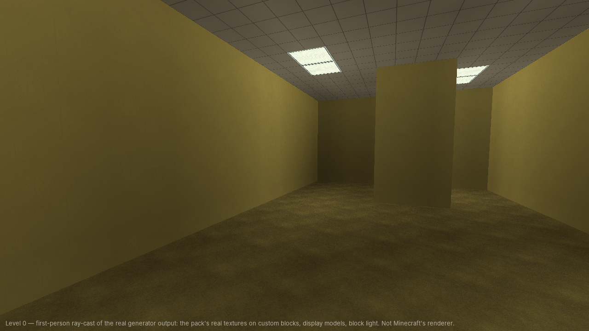
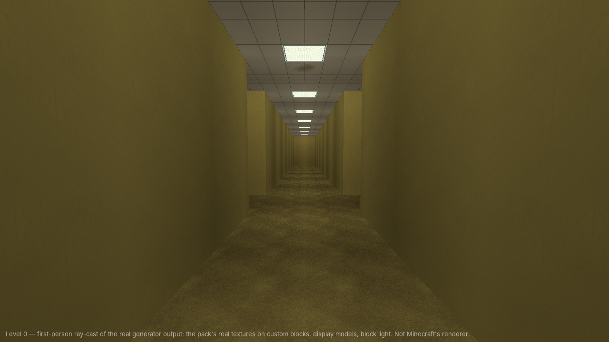
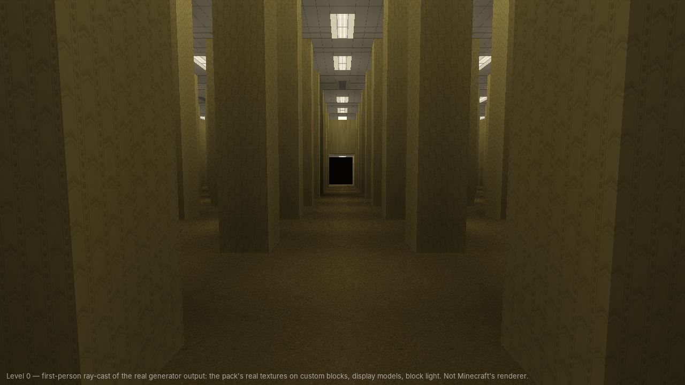
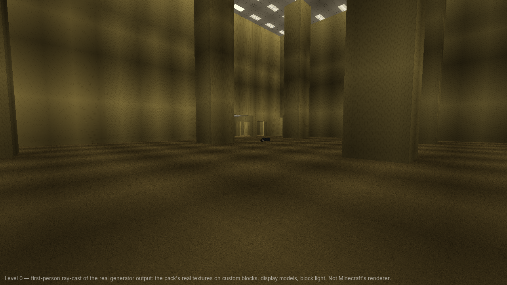
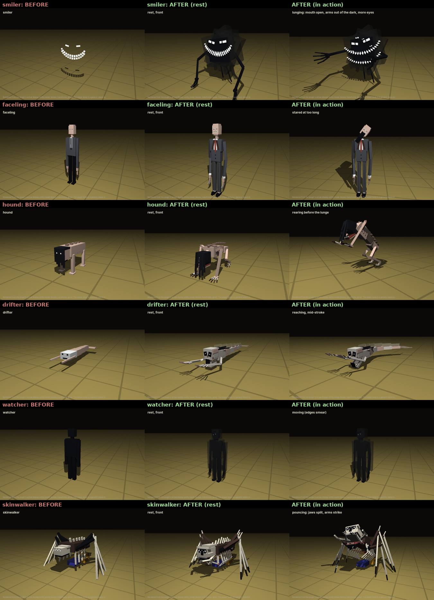
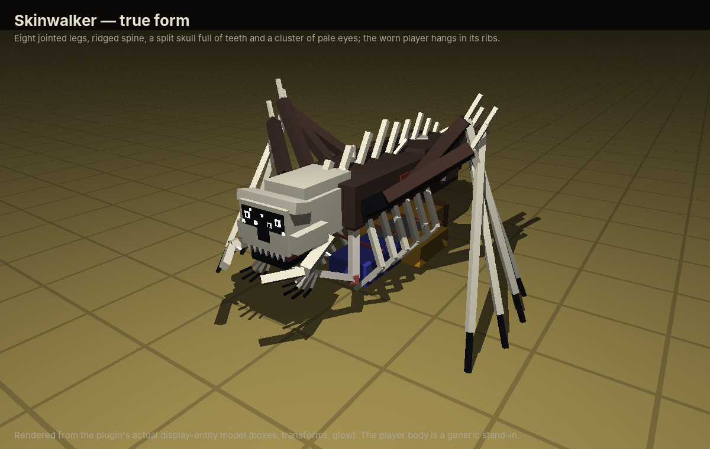
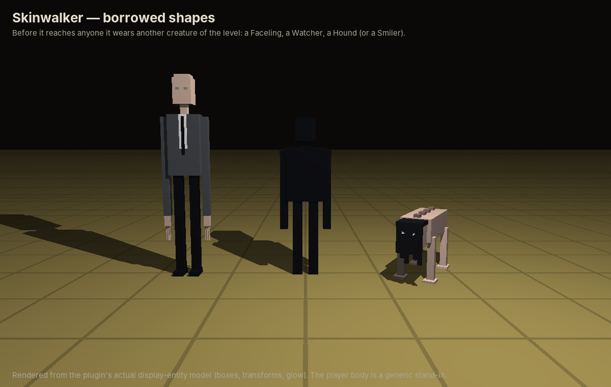

# Backrooms — a five-level dimension for Paper 1.21.11

Backrooms adds a separate alternate reality to a Paper 1.21.11 server. It is built from five generated worlds, display-entity props, surface details and creatures, light effects, fog, and an original positional soundscape. Players need no mods. Custom audio arrives through a resource pack that is bundled inside the plugin JAR; without it, players hear vanilla fallback sounds. The worlds never touch the Overworld, the Nether or the End.

| | |
|---|---|
| Server | Paper **1.21.11**, Java 21 |
| Plugin JAR | `build/libs/Backrooms.jar` (one file, about 20 MB: the plugin and the Java resource pack; the Bedrock companion pack is assembled from it on first start) |
| Dependencies | none at runtime; no NMS, no ProtocolLib, no packets |
| Audio | original, synthesised offline, CC0 (see `pack/MANIFEST.md`) |
| Worlds | `backrooms_level0`, `backrooms_level1`, `backrooms_poolrooms`, `backrooms_level4`, `backrooms_plains` |

---

## Installation

1. Put `Backrooms.jar` in `plugins/` and start the server once. The five worlds are created on first start; each takes a few hundred milliseconds. The resource pack is extracted to `plugins/Backrooms/resourcepack/Backrooms-pack.zip`, and the Bedrock pack is assembled next to it, reusing the same audio.
2. **Custom audio (optional but recommended):** clients download resource packs from a public URL, which a plugin cannot provide on its own.
   - **Default, mc-packs.net:** upload `plugins/Backrooms/resourcepack/Backrooms-pack.zip` at <https://mc-packs.net> once per plugin version. Its download link is `https://download.mc-packs.net/pack/<sha1>.zip`, which is exactly what `resource-pack.url` resolves to (the console prints the SHA-1). Then run `/backrooms audio reload`.
   - **Any other HTTPS host:** set `resource-pack.url` (you can use `{sha1}` in it).
   - **Built-in host:** set `resource-pack.host.enabled: true` with a port your host exposes publicly and a `public-address`.

   **Also set in `server.properties`:** on every start the plugin makes sure `resource-pack`, `resource-pack-sha1`, `resource-pack-id`, `resource-pack-prompt` and `require-resource-pack` carry the values under `resource-pack.server-properties` in `config.yml` (the defaults are the pack in this JAR on mc-packs.net, with `require-resource-pack=true`). Minecraft reads that file only at startup, so the **first change needs one restart**; the original is kept as `server.properties.backrooms.bak`, and every other line is left untouched. The console logs a `[ResourcePack]` warning on **every boot** while a pack is set (URL, SHA-1, id, prompt, and that decliners are kicked), and another if the SHA-1 is not the pack inside the JAR. `manage: false` stops the plugin editing the file; the warning still appears. The pack id is shared with the plugin's own offer when the SHA-1 matches, so clients load the pack once.

   The plugin checks the URL and **only offers the pack once the URL answers**. Until then the console says what is missing and players keep the vanilla sounds. `/backrooms audio status` shows the state.
3. **Bedrock players (Geyser/Floodgate):** they never receive the Java pack. To try custom sounds for them, copy `plugins/Backrooms/resourcepack/Backrooms-bedrock.mcpack` into Geyser's `packs` folder, restart, and set `bedrock.custom-sounds: true`. This is **untested**; see the limitations below.
4. Edit `plugins/Backrooms/config.yml` if you want to, then restart the server or run `/backrooms reload`.
5. Enter with `/backrooms enter` (this needs `backrooms.use`, which everyone has by default) or `/backrooms enter <player>`.

> **Upgrading from an earlier build:** this version uses generator version 3 (new palettes, the parking garage, new transitions). Existing level worlds keep their old blocks and log a warning, and new chunks would not match old ones. Delete the `backrooms_*` world folders and their entries in `plugins/Backrooms/data/worlds.yml` to regenerate. Display details, fog and audio also work in old worlds, because none of them is stored in the world.

> Use `/backrooms reload` rather than `/reload` or plugin managers. The worlds keep a reference to the generator, so hot-swapping the JAR is not supported.

**Building from source:** run `./gradlew build` (or `gradle build`). The API comes from `repo.papermc.io`. If that host is unreachable, pass a local Maven mirror with `-PlocalPaperRepo=/path/to/repo`. The JAR in this branch was built that way, against a Paper API 1.21.11 compiled from PaperMC's `ver/1.21.11` source.

---

## How players experience it

- **Getting in:** there are two ways:
  - **Suffocate in sand, gravel or concrete powder** (anything that falls) outside the Backrooms for about 2 seconds. Reality gives way, and you take no suffocation damage while it counts. Ordinary suffocation in a normal wall is never affected.
  - Run `/backrooms enter`. It can be turned off and limited to certain worlds. Admins can also send players in.

  Either way you **fall in**:
  - You appear high in the dark above Level 0, looking down, and fall straight down with your sideways movement locked.
  - Just before you reach the roof, a 3×3 shaft opens through the roof and ceiling.
  - You land in the Lobby with no fall damage, and the shaft closes behind you about 2 seconds later.

  Each entry lands in a different part of Level 0, so players don't all share one spot. The place they left from is saved as their **return point**.
- **Moving between levels:** the levels form a chain: **Level 0 → Poolrooms → Habitable Zone → Office → Plains → exit**.
  - Past Level 0, every district holds the way onward. A rarer way back to the previous level appears in about 40% of districts.
  - Level 0 is the exception. Its only way on, the cold seam into the Poolrooms, appears in about a third of districts (roughly one per 550 blocks of maze). It only gives itself away with a sound when you are within 10 blocks.
- **Getting out:** players have to reach the end. The only exit is the giant doorframe in the Plains. `/backrooms leave` is admin-only by default. Dying also returns the player to their return point (`death.mode: RETURN`).
- **Surviving:**
  - Generated barrels hold limited supplies the first time they are opened: Almond Water, rations, batteries, flashlights, and damp notes that hint at the transitions.
  - **Sanity** drains in the dark and near creatures. It recovers in light, in safe rooms and near other players.
  - Low sanity brings whispers, a heartbeat, nausea and private hallucinations.
  - The **Flashlight** casts a moving light that only clients see.
  - Answering a ringing phone gets a whispered direction and distance to the nearest way onward. Radios carry warnings about the creatures.

### Transition map

| From | Structure (trigger) | To | How often |
|---|---|---|---|
| Level 0 | Cold tiled seam (crouch against it, or stand there for 3 s) | Poolrooms | ~35% of districts |
| Poolrooms | Grey service-door booth | Habitable Zone | every district |
| Poolrooms | Black drain at the bottom of an 8-deep pool | Level 0 (back) | ~40% |
| Habitable Zone | Elevator lobby (stand in the car for 2 s) | Office | every district |
| Habitable Zone | Flooded tiled stairwell (go down into the water) | Poolrooms (back) | ~40% |
| Office | A window that is far too bright | Plains | every district |
| Office | Stairwell in the largest room | Habitable Zone (back) | ~40% |
| Plains | Giant free-standing doorframe | **Exit** | every district |
| Plains | Bunker hatch in the grass | Office (back) | ~40% |

The yellow house and the backyard pools are still in the Plains, but they lead nowhere now.

---

## The five levels

**Lighting rule:** there are no vanilla light-emitting blocks anywhere: no lanterns, froglights, sea lanterns, end rods, glowstone, torches or bulbs. Every light is an invisible `LIGHT` block under a fixture:
- in Level 0, a **flush ceiling troffer block** (a custom block whose model glows at full brightness);
- elsewhere, a display-entity fixture model (tube light, cage lamp, skylight, pool lamp).

Some fixtures are dead and some flicker. Flicker and blackouts switch the troffer blocks off together with their light, client-side.

**Custom textured blocks.** Level 0, the Poolrooms, Level 1 and Level 4 are built from the Backrooms' own textured blocks, which exist only through the resource pack:
- **How they work:** each one is a powered note block in a state that ordinary play almost never produces (it needs a mob head on top and redstone power), and the pack gives exactly those 38 states their textures. Every other note block keeps its vanilla look. The Plains use vanilla grass and moss.
- **Inside the Backrooms:** note blocks are frozen. They ignore neighbour updates, cannot be retuned and never play.
- **Without the pack:** players who have not loaded it cannot fall into the Backrooms; they are told to accept it. This gate is skipped while the pack URL is unreachable, so a hosting problem never locks anyone out.
- **Bedrock** players cannot load the Java pack. With `bedrock.allow-entry` (default on) they are let in and see note blocks.
- **Turning it off:** `resource-pack.custom-blocks: false` brings back the vanilla look-alike blocks (restart needed; chunks already generated keep their blocks).
- **Sources:** `src/main/resources/custom-blocks.json` lists every block. The textures are built by `tools/textures/build_textures.py` from the Backrooms PBR pack the server owner supplied; that script also draws the pool tiles and light panels. Shader users get LabPBR `_s` maps: the panels glow and the tiles are glossy.
- **Licensing:** the source textures come from a third-party pack (credited in `pack/MANIFEST.md`). Confirm you may redistribute them before you publish the pack.

**Surfaces:** each level has its own palette, and pattern comes from real blocks: wallpaper seams, wainscots, grout grids and carpet tiles. Thin **display overlays** add what a block cannot (see *Surface details* below):
- architecture: ceiling seams, coping, trims, pipes, ducts, grilles, sills, outlets;
- deterioration: water stains, faded and peeling paper, cracks, rust and damp patches.

Deterioration is clustered by smooth noise, so most surfaces are clean and damage concentrates in a few worn areas.

Each level uses a **different generation rule**:

**Level 0 — The Lobby.** *The only maze.* An 8-block grid of wall lines joined by a spanning tree with extra loops.
- **Look:**
  - mono-yellow chevron wallpaper, with a dotted paper in broad patches and water-stained paper at the top of damp walls;
  - damp mustard carpet, soaked dark in places, with puddles;
  - a drop ceiling of stained tiles;
  - flush fluorescent troffers in a staggered grid.
- **Each 64 x 64 region is one of four kinds of space:**
  - **Rooms (about two thirds):** 4 blocks tall. Short wall sections come out of the main walls: fins two blocks deep, single pilasters, and thickened stretches. They stay at least a block clear of every doorway on their wall and out of the room's middle 3 x 3, so the walk through a room is the same with or without them. Some neighbourhoods give every wall a pilaster in its middle.
  - **Long halls:** parallel 3-wide corridors running the whole region, joined by two cross passages. They carry straight on into the next hall region with the same direction.
  - **Pillar fields:** one open floor with a 1 x 1 column every 4 blocks, floor to ceiling, 4 or 8 blocks high.
  - **Tall halls:** 21 blocks high with 3 x 3 columns. The troffers are far overhead and invisible lights hang in the air below them.
- **Displays:** rare water stains with drip runs; faded rectangles where something hung.
- **Sectors:** dead sectors (most panels off), damp sectors, and regions that repeat their neighbour.

**The Poolrooms.** *Three storeys of tile.* A lower, a main and an upper floor, 32 blocks apart, joined by tiled spiral stair towers (one per 60-block region, with a labelled door on every floor). Everyone arrives on the main floor. Each region of each floor is one of five spaces (six with canal courts, below):
- **Bays:** 12-block bays between 2×2 pillars: dry walks, wading pools, deep lakes with submerged steps.
- **Dry tile:** walking areas with raised platforms and free-standing screens.
- **Bright rooms:** no walls at all, under a 22–28-block ceiling covered in light panels, often with a reflecting pool and a giant Greek head rising out of it.
- **Long tall hallways:** 22 blocks high and 180 long, with 2×2 holes in the walls into small places: pools, steps down into sunken pools, busts, glowing alcoves.
- **Massive halls:** 56 blocks high, with a gallery, a grand staircase, a half-sunk 25-block Greek head and a tiled **water slide**. Step into the chute at the gallery to ride it down into the pool.

**Water slides everywhere** (`slide-chance`, `fun-slide-chance`; worlds made before them have none, see below). Every region and storey may get a slide, each one different (a seeded path of straights, banked turns, helixes and steep drops):
- **Three kinds of chute**, built from display entities: an **open** half-pipe, a **half-covered** one under arched ribs, or a **fully enclosed** tube of tinted glass you can see out of. Most are wet, with water glints running down the chute (an animation that loops seamlessly) and drips; some run dry, which grips more and rides a little slower.
- **Storey slides** start on a railed platform with a stair and **bore through walls and the floor slab** down to the storey below, landing in a pool cut into the floor with steps out. Some land in a **pocket**: a small walled pool room with one door, a place you only find by riding there. **Fun slides** start on a taller platform and land in a pool on the same floor.
- Tunnels are dug only where they cannot let any water out, never through stair towers, transitions or massive halls; open stretches stand on quartz pillars; bored stretches are lit.
- **The ride:** walk onto the top of the platform and you sit down in an inflatable ring that follows the chute exactly. Speed comes from the slope (gravity, less friction when wet or in a tube, air drag): drops and helixes speed you up, the runout slows you, and you are thrown out over the pool. Rides take about 4 s (fun slides) to 12 s (storey slides) and peak around 10-15 m/s. No fall, suffocation or wall damage while riding or for a few seconds after. A ride ends cleanly if you quit, die, change world or are teleported. Massive-hall slides use the same ride.
- Previews: [`docs/previews/slides-*.png`](docs/previews).

- **Canal courts** (`canal-chance`; new worlds only, see below): a promenade with an iron railing round a sunken canal, four 6-wide bridges to a two-storey pavilion in the middle. The pavilion has stepped arches (the bridges lead into them) and window slits, so you see the other sections across the water and can walk to every one of them. Inside: a cloister, a pool court with the Greek head, and a stair up to a roof terrace that looks down into the court. Flights of steps climb out of the canal, so falling in is never a trap. Previews: [`docs/previews/canal-*.png`](docs/previews).

Floaties drift and bob on the water: rings, ducks, mattresses, beach balls. The way on (grey service door) and the drain back to Level 0 are on the main floor.

**Level 1 — Habitable Zone.** *An endless underground parking garage* in 32-block bays, built from its own textured concrete blocks (walls, stained walls, floor with oil and cracks, stall lines, hazard stripes, columns, ceiling).
- Drive aisles with stall rows, columns under beams, pipe runs that **leak steam** (visible jets and a positional hiss), ducts, rare supply rooms and safe rooms.
- **Drivable cars:** right-click a parked car to get in. The first seat is the driver; up to 4 riders. W/S accelerate and reverse, A/D steer, Space brakes, Sprint sounds the horn, Sneak gets out. Headlights, taillights and brake/reverse lights follow the controls; an abandoned car turns back into a parked one.
- **Blackouts** here bring Smilers around you, gone when the lights return.

**Level 4 — Office Towers.** *2000s office towers in an endless night.* No ground, only the dark far below; walking off an edge is death.
- Every 64-block plot holds a tower of 3–8 floors around a core with a switchback stairwell and a **lift**. Floors are open plan: cubicle pods with CRT PCs behind partitions, glass-fronted private offices and conference rooms for the more important people, a lobby with reception on the ground floor, glass curtain walls.
- **Sky bridges** (enclosed or railed) join neighbouring towers at various floors; any group of towers is connected.
- **Lifts:** press a floor button in the car (or sneak inside it for a menu). The doors close, the motor runs, a ding, and you are on that floor. 10% of rides (`lift-stray-chance`) open the doors in a **random other Backrooms level** instead.
- Built from its own textured blocks (facades, floor and lobby tiles, partitions, walls, columns, lift steel, roof, ceiling).

**The Plains.** *Empty fields under a sky stuck at sunset.* Mostly grass and moss, no roads and no wires.
- Lone houses stand in the grass facing nowhere, and now and then a handful sit together at odd angles as if dropped. Some are wrong (no door, a door too high, sunk, floating, a door into a wall).
- **Giant everyday things**, about 40 blocks tall, stand in the fields: a chair, a lamp, a traffic cone, a rubber duck, a CRT, a telephone, a fan, a shoe, a mug, a teddy, a pencil, a hydrant, a bucket, a light bulb.
- **Sinkholes:** irregular holes about 100 blocks across that narrow to a few blocks and fall out of the world. Jumping in kills you.
- The exits out of the Backrooms are here, and only here.

> Distant colossi need clients to track entities far away. Raise `world-settings.default.entity-tracking-range.display` in `spigot.yml` if they pop in late; `displays.outdoor-activation-radius-chunks` controls how far they spawn.

### Fog

Fog uses no packets or resource pack. The client draws fog at the edge of the chunks the server sends it, so Backrooms lowers each player's **send view distance** inside a level:

| Level | Resting fog distance |
|---|---|
| Poolrooms | 7 chunks |
| Habitable Zone | 5 chunks |
| Plains | 6 chunks, with drifting ash |
| Level 0, Office | unchanged (walls do that job) |

The `fog` event rolls a fog bank in for 1–2 minutes: 3 chunks, with thick ash particles that only that player sees. The player's normal view distance is restored when they leave the Backrooms. Configure it under `fog:`.

### Sound

Every sound is original: synthesised offline with numpy/scipy, plus espeak-ng formant voices for speech. The pack is CC0. The pipeline in `tools/audio/` is deterministic, and two runs give byte-identical files. `pack/MANIFEST.md` lists every asset, how it was made, and how to add your own licensed tracks.

The pack has 71 sound ids and 873 Ogg Vorbis files: mono positional sounds, mono beds played on the listener, and two stereo ambient music mixes. The pack is 28.2 MB, textures included. The only third-party audio is the Level 0 bed recording, which you can swap for a synthesised one. Everything else is original CC0.

Where sounds are in the pack, they come in several versions: a dry take plus pre-reverberated versions for each room type (carpet, office, concrete, pool, corridor, open), and low-passed "muffled" versions for sources behind walls. The engine picks one by room and line of sight. Every loop is exactly 8, 10 or 12 s with faded ends.

**The constant bed.** Every level has a long seamless loop that plays on the player, so it follows them everywhere and never stops:

| Level | Bed | Length |
|---|---|---|
| Level 0 | `bed.level0`: a real fluorescent-light recording supplied with the texture pack, made into a seamless loop (`audio.level0-bed: synth` switches to the original synthesised `bed.level0_synth`) | 60 s |
| Poolrooms | `bed.poolrooms`: pump and circulation hum, water lapping | 40 s |
| Habitable Zone | `bed.garage`: ventilation, distant machinery, hissing steam leaks, metal ticking | 48 s |
| Office | `bed.office`: air conditioning, ballast buzz, server hum | 40 s |
| Plains | `bed.plains`: faint wind | 48 s |

- It is re-triggered every 2 ticks of server time, 300 ms before the end, so its faded ends cross.
- In Level 0 and the Office a blackout cuts the buzz with the lights.
- Settings: `audio.bed`, `audio.bed-volume`.
- **Music** always plays on the player too, never at a place.
- **Positional sounds:** the loops near real sources and the one-shot scares below are unchanged, so a knock or footsteps can still come from somewhere.
- **Habitable Zone one-shots:** steam bursts, metal clanks and long metal groans.

| Level | Loops (from real sources) | Events (rare ones marked *) | Music |
|---|---|---|---|
| Level 0 | ballast hum at every lit fixture; a denser hum under clusters | flicker crackle, pops, distant knocks and impacts, footsteps*, whispers behind you*, arcs* | `lobby_1/2`*, muffled, from somewhere just past the lights |
| Poolrooms | water lapping, pool circulation, damp room tone | drips near and far, splashes*, bubbles, tile footsteps*, murmurs*; underwater, only a muffled water bed | `pool_1/2`*, positional, with pool reverb |
| Habitable Zone | vents and ducts, transformer buzz at junction boxes, distant machinery | creaks, pipe knocks, drips, machines starting*, concrete footsteps*, conversations behind walls* | `garage_1`*, with concrete reverb |
| Office | air conditioning at vents, fluorescent hum | clicks, printer, phone*, broken speaker*, conversations*, PA announcements*, spoken lines* | an old radio on a few desks playing `office_radio_1/2`, clearer as you approach |
| Plains | none; long silences | grass rustle, distant unidentified sounds*, a far cry* | `plains_1/2`*, very rare, stereo, never constant |

Flickers and blackouts are synchronised with the light effects.

### Maps

Top-down maps rendered from the real generators (seed `5eedbacc`, centred on 0,0). Regenerate them with `RENDER_MAPS=docs/maps gradle test --tests '*MapRenderTest'`.

| | |
|---|---|
|  |  |
|  |  |
|  | |

---

## Creatures and anomalies

None of these is a renamed vanilla mob. Each is a coordinated group of display entities with smooth interpolated motion and limb animation, moved by a bounded A* search over real blocks. Creatures that can be hit have a real `Interaction` hitbox, and damage follows the attacker's attack-damage attribute and cooldown.

| Type | Levels | Class | Behaviour and counterplay |
|---|---|---|---|
| **Smiler** | 1, Plains | threat | A shapeless smoky dark mass: slanted reflective eyes and a grin of interlocking needle teeth. Up close, more eyes slide out of the dark, the mouth opens and two long black many-jointed arms reach for you. Found only in the dark, and in Level 1 every blackout brings a few of them around you, gone when the lights return. Freezes while watched; stare for about 4 s and it dissolves. Creeps forward when you look away. Light at ≥11 keeps it at bay. A giggle warns you when it is close. |
| **Faceling** | 4 | sighting | Tall and thin in a dated suit, arms down to its knees, long twitching fingers, a smooth head with only smudges where a face should be. Stare at it too long and its head drops sideways while the seam of a mouth tears open down to the neck. Stalks at 12–20 blocks and leaves when stared at. Harmless, but drains sanity; also appears as **private hallucinations** in Level 4. |
| **Hound** | 1, 4 | threat (killable, 30 HP) | A starved naked human on all fours: every rib and vertebra showing, elbows bent the wrong way above its shoulders, clawed fingers, a curtain of black hair over white eyes and a mouth too wide for its face. Rears onto its hind legs, jaw gaping and eyes flaring, before it lunges. **Hunts by sound** (sprinting is loud, sneaking almost silent) and by sight. Growls and lowers its head before a lunge. Flees when badly hurt. |
| **Watcher** | 0, Poolrooms, 1, Plains | stalker (hit it and it is gone) | A flat black silhouette at the end of a hall, too tall and too thin, head cocked, with two pinprick eyes you only notice up close. Its edges smear while it moves. While anyone looks at it, it does not move at all; the moment nobody is, it closes the distance fast and silently. Stare it down for about 7 s and it disappears. If it reaches you: damage, darkness, and the lights flicker. |
| **Drifter** | Poolrooms | threat (20 HP) | A drowned eel-long body behind a human face frozen mid-scream, hollow eyes, trailing hair and two thin arms reaching ahead; it swims with its whole length. Bubbles warn you. It drags swimmers down; leave the water or strike it. |
| **Skinwalker** | every level | threat (true form 80 HP) | Wears other creatures (only ones that belong to the level), then people. See below. |
| **Bacteria** | 0 | threat (120 HP, flees when badly hurt) | "The Lifeform" of the found-footage films: very tall, black and stick-thin, limbs wound in cable-like strands, long fingers, a small blank head, moving in glitching jerks. **It hunts by sound and movement, not sight.** It roams, freezes to listen when it hears you (sprinting is loud, sneaking barely audible), and goes to look; anyone moving near it is hunted with a distorted scream, faster than you can run. **Stand completely still and silent and it loses you**: if it is right next to you it leans over you, breathing, then wanders off, unless you move. Now and then it imitates a human voice. |

**Who lives where:** Level 0 Bacteria and Watchers; Poolrooms Drifters and Watchers; Level 1 Hounds, Watchers and Smilers; Level 4 Hounds and Facelings; the Plains Watchers and Smilers; the Skinwalker in every level. An older `config.yml` without `creatures.table-version: 2` keeps its enable/damage/health settings but takes these level weights.

Each model is built from 40–160 display parts on a small skeleton, so jaws, arms, fingers, legs and heads animate on their own (rendered sheets for each creature are in [docs/creatures](docs/creatures); regenerate with `RENDER_CREATURES=docs/creatures gradle test --tests '*CreatureRenderTest'`). Idle animation runs at half rate and only changed transforms are sent, to keep the packet load reasonable.

Creatures notice everyone except spectators, so they also appear and stalk around **creative-mode** players (useful for testing). They only ever **hurt** players in survival or adventure mode.

### The Skinwalker

1. **Borrowed shape.** It appears as another creature of the level: a Faceling, Smiler or Watcher in Level 0, a Hound or Faceling in the Habitable Zone, a Watcher or Faceling in the Office. It behaves almost like one, except that it keeps coming closer while nobody is looking. Now and then something cracks quietly. Strike it and the disguise splits open into its true form.
2. **Worn player.** If it reaches a player who has company within 48 blocks, it takes them.
   - **The victim** is locked inside their own body. They are put in spectator mode watching through its eyes, and cannot move, leave the view, change game mode, type in chat, run commands (except with `backrooms.bypass.skinwalker`) or talk on voice chat. Their fly speed is set to 0 and every quarter second they are pulled back onto the body and the camera if anything let go, so they cannot fly away from the monster (their old fly speed is restored with them). To everybody else they look like a normal player in the tab list, not a faded spectator: the server tells the other players' clients that they are in survival mode (reflection on the server's player-info packet; if that fails it logs once and the entry simply stays faded). Their own tab list still shows them as a spectator, because their client needs that.
   - **The body** is a `Mannequin` wearing the victim's skin, name and visible equipment.
   - **It acts human:**
     - walks with the group a little behind the leader, at their pace, with footsteps;
     - looks where they look, or at the nearest face; idles and glances around;
     - copies sneaks, jumps and arm swings a beat late;
     - when punched, takes it and punches back harmlessly;
     - now and then repeats a line the victim typed in chat inside the Backrooms;
     - with Simple Voice Chat, plays back recordings of the victim's actual voice from where the body stands.
   - **Its tell:** sometimes it stares at someone a little too long.
3. **True form.** It stops pretending after `disguise-seconds` (150), or after 6 punches within 20 seconds, or when the group is gone.
   - Its back cracks open into a spider-like thing on eight long jointed legs, with a ridged spine and a split skull full of teeth. The victim's body hangs in its ribs, and the victim is still watching from inside.
   - It scuttles at about 6 blocks per second, chittering, and pounces for 9 damage.
   - **Kill it** (80 HP) and the victim is freed alive.
   - If it survives `true-form-seconds` (90) or kills someone, the victim dies.
   - **A lone player is never worn.** There is nobody to fool, so it goes straight to its true form.

**Safety:** the victim's original game mode is saved in their player data before anything changes. Disconnecting, an admin `entity clear`, `/backrooms reload`, plugin disable and crash recovery on the next join all give the player back their game mode on safe ground.

**Voice and chat mimicry, and privacy:**
- Inside the Backrooms, the plugin keeps the last few chat lines and, with Simple Voice Chat, about the last 12 short utterances of each player. These are held **in memory only**, never written to disk, and dropped when the player leaves the Backrooms or disconnects.
- Turn the features off with `skinwalker.chat-mimic` / `skinwalker.voice-mimic`. Tell your players if you keep them on.
- Simple Voice Chat is used **by reflection only**: none of its code is included in this plugin, and the plugin works normally without it.
- Without it there is no voice muting or voice playback. The other locks still apply.

The repeated chat line is sent in vanilla `<name> message` format, so a server with custom chat formatting will show the difference.

Spawning is deliberately rare:
- Each player gets an attempt every 15 s, with chances per level.
- Caps apply per player (2) and per level (8).
- Creatures never spawn in safe rooms or in plain sight (Facelings excepted).
- Each type has its own placement rules (Smilers in the dark, Drifters in deep water).

## Environmental events

**Lights misbehave in every level**, at any time:
- **Per player:** flicker, blackout and lights-out can happen to anyone.
- **Independent roll:** every 20 s, each occupied level has an `events.light-event-chance` (default 0.25) of one of them around a random player.
- **Level 1 blackouts** bring `events.blackout-smilers` Smilers around each player, gone when the lights return.

**Announcements:** about every 40 s (`audio.announce-seconds`) a PA announcement or a voice plays:
- Level 0: announcements, distant phrases, whispers behind you;
- Poolrooms: announcements, murmurs;
- Level 1: announcements, radio chatter, voices behind walls;
- Level 4: announcements, conversations.

`flicker`, `blackout` (raises spawn chances), `lights_out` (lights die one by one toward you), `footsteps`, `knocking`, `door_behind` (a real door behind you opens, then closes), `machinery`, `pool_echo`, `phone_ring`, `wind` (Plains), `fog` (a fog bank rolls in: Plains, Poolrooms, Habitable Zone), `deja_vu` (a hallucination), `hum_shift`.

For players with the pack, flickers crackle at the fixture, and blackouts wind the ballast hum down and back up. The vanilla versions of these events still play for everyone else.

All light effects are **client-side only** (`sendBlockChange` on the invisible `LIGHT` blocks, plus dimming the fixture models). The world is never modified, so a crash can never leave lights broken.

---

## Commands

Every group has the same shape: `list`, then actions. Wherever a command acts on players, `[targets]` is a name or a vanilla selector (`@a`, `@s`, `@p`, `@r`, with filters such as `@a[distance=..20]`); left out, it means you. `/br` is an alias, and `/backrooms help <group>` shows one group in full. Everything that names a player or level also works from the console.

| Command | Permission | Notes |
|---|---|---|
| `/backrooms help [group]` | — | Generated from the command tree, showing only what you may use |
| `/backrooms enter [targets]` | `backrooms.use` (self, if `entry.allow-self-enter`) · `backrooms.admin.teleport` (others) | Safe entry into Level 0; saves the return point |
| `/backrooms leave [targets]` | `backrooms.admin.teleport` (or self, if `entry.allow-self-leave`) | Back to the saved return point or the fallback |
| `/backrooms goto <level> [targets]` | `backrooms.admin.teleport` | Admin spawn point if set, otherwise the safe cell nearest the origin |
| `/backrooms levels` | `backrooms.use` | The five levels and their status |
| `/backrooms audio list [filter]` | `backrooms.admin.audio` | Every sound id |
| `/backrooms audio play <sound> [targets] [volume] [pitch]` | `backrooms.admin.audio` | e.g. `/br audio play knock.distant @a 1 0.8` |
| `/backrooms audio stop [targets]` | `backrooms.admin.audio` | Stops what the plugin is playing to them |
| `/backrooms audio status \| reload \| debug` | `backrooms.admin.audio` | Engine and pack state · re-check the pack URL and restart · action-bar overlay |
| `/backrooms assets list [category \| filter]` | `backrooms.admin.assets` | The catalogue (about 130 assets in 8 categories: pool, slides, lights, office, garage, lobby, plains, creatures) |
| `/backrooms assets spawn <asset> [x y z] [yaw] [seed]` | `backrooms.admin.assets` | Where you look, or at coordinates (`~` allowed). Saved in `data/assets.yml`, works in any world. Suffixes: `panel_light:flicker`, `floatie_ring:2`, `slide:enclosed:dry:12`, `creature:smiler` |
| `/backrooms assets remove [radius \| all]` | `backrooms.admin.assets` | Placed assets near you (default 3 blocks); `all` asks for `/backrooms confirm` |
| `/backrooms assets info` | `backrooms.admin.assets` | What is near you, with the command that spawns a copy of it |
| `/backrooms slide list [radius] \| info` | `backrooms.admin.slides` | Slides starting near you: generated, massive-hall and placed ones |
| `/backrooms slide ride [targets] [number]` | `backrooms.admin.slides` | Puts players on the nearest slide (or number n of the list) |
| `/backrooms creature list` | `backrooms.admin.entities` | Creature catalogue |
| `/backrooms creature spawn <type> [amount] [targets]` | `backrooms.admin.entities` | Natural placement rules near each target, with a fallback in front of them |
| `/backrooms creature clear [radius \| level [level]]` | `backrooms.admin.entities` | Clearing a whole level needs `/backrooms confirm` within 15 s |
| `/backrooms creature skinwalker <targets>` | `backrooms.admin.entities` | A skinwalker takes them now, with or without company (alone, it drops the disguise at once and carries the body under its true form). Kill it to free them |
| `/backrooms event list` · `event trigger <event> [targets \| level]` | `backrooms.admin.events` | For players, or for everyone in a level |
| `/backrooms spawnpoint set [level] \| clear <level> \| show [level]` | `backrooms.admin.teleport` | Where `goto` lands; `set` checks the spot is safe |
| `/backrooms give <item> [targets] [amount]` | `backrooms.admin` | `almond_water`, `flashlight`, `battery`, `ration`, `note` |
| `/backrooms status` | `backrooms.admin.debug` | Worlds, players, chunks, threats, displays, placed assets, riders, tick cost |
| `/backrooms debug [on\|off]` | `backrooms.admin.debug` | Action-bar overlay (level, cell, zone, nearest transition, light, sanity) plus a console log |
| `/backrooms reload` | `backrooms.admin.reload` | Restarts services without unloading worlds or duplicating schedulers |
| `/backrooms confirm` | — | Confirms a pending destructive action |

**Renamed in this version** (the old forms still work, hidden, for one release): `level` → `goto`, `setspawn` → `spawnpoint set`, `entity …` → `creature …`, `skinwalker` → `creature skinwalker`, `audio test <sound> [player]` → `audio play <sound> [targets]`.

**Permission defaults:**

| Permission | Default |
|---|---|
| `backrooms.use` | everyone |
| `backrooms.admin` and its children (`.teleport`, `.entities`, `.events`, `.debug`, `.reload`, `.audio`, `.assets`, `.slides`, plus `backrooms.bypass.commands`) | op |
| `backrooms.bypass.protection` | nobody (build inside the Backrooms) |
| `backrooms.bypass.skinwalker` | op (can still run commands while being worn) |

---

## Configuration reference (`config.yml`)

| Key | Meaning |
|---|---|
| `seed` | Base seed; `0` picks a random one once. **Locked**: stored in `data/worlds.yml` |
| `world-prefix` | World folder prefix |
| `levels.<level>.enabled` | Load this level's world. A disabled level's transitions show "the way is sealed". Players left in a disabled level are sent home when they join |
| `levels.<level>.biome` | Biome key for ambient particles, sounds and water colour |
| `levels.<level>.generation.*` | **Locked** per level when its world is created. Each level has its own keys: Level 0 has hall, thick-wall, repeat and loop chances plus `poolrooms-chance` (how rare the seam onward is); the Habitable Zone has `supply-room-chance`; the Poolrooms have water ratio, screens and the massive-hall, hallway, bright-room, `canal-chance`, `slide-chance` and `fun-slide-chance` chances (the last three are absent from the locked settings of worlds made before they existed, which counts as 0, so their layout never changes; delete the world to get them); Level 4 has bridge, dark-floor and `lift-stray-chance` (default 0.10); the Plains have lone-house, hamlet, giant and sinkhole chances. Every level past Level 0 also has `back-chance` (the way back), plus landmark chance and decoration density |
| `entry.allow-self-enter` / `allow-self-leave` / `allowed-worlds` / `spread-radius` / `title` | Entry rules |
| `entry.fall.enabled` / `entry.fall.height` | Enter by falling from this many blocks above the roof (default 90); off = instant teleport |
| `entry.suffocation.enabled` / `entry.suffocation.seconds` | The sand/gravel suffocation trigger and how long it takes (default 2 s). It honours `allowed-worlds` and needs `backrooms.use` |
| `return.fallback-world` | Used when a return point is missing or its world is gone |
| `death.mode` | `RETURN`, `LEVEL0` or `STAY`. `death.keep-inventory` keeps items and XP for deaths inside |
| `restrictions.*` | Block protection, ender pearls, chorus fruit, portals, beds, music suppression, `blocked-commands` (e.g. `home`, `spawn`, `tpa`, `warp`, `back`) |
| `transitions.*` | Arrival cooldown, dwell/intent times, arrival protection |
| `displays.*` | Activation radius (chunks), `outdoor-activation-radius-chunks` (Plains, default 8), `max-entities-per-chunk` (default 80), `max-entities-per-world`, chunks per tick, animation interval, view range, hazards on/off |
| `displays.details.*` | Surface details. `enabled`, `performance-mode` (keeps only the most important architectural details), `density`, `aging` (deterioration intensity) and `environment` (small extras), each 0–2. Also `max-per-chunk` (default 28, on top of the props), `view-range` (default 0.45 = 29 blocks), and `levels.<level>.enabled` / `.density` |
| `fog.*` | `enabled`, `bank-view-distance` (default 3), `levels.<level>` resting fog distance in chunks (0 = leave alone) |
| `audio.*` | Toggles: `enabled`, `bed` (the constant per-level bed on the player), `ambient`, `music`, `voices`. `bed-volume` 0–2, `level0-bed` `recording`/`synth`. Tuning: `event-density`, `rare-frequency`, `music-frequency`, `max-sources` (simultaneous loops per player, default 6), `distance-scale`, `acoustic-quality` (`low`/`medium`/`high`), and `levels.<level>` loudness 0–2 |
| `resource-pack.server-properties.*` | `manage` (write the keys into `server.properties`, default true), `url`, `sha1`, `id`, `prompt` (JSON text), `required` (kick decliners) |
| `resource-pack.*` | `enabled`, `url` (default mc-packs.net with `{sha1}`), `required` (kick players who decline), `custom-blocks` (textured blocks, or vanilla look-alikes), `required-for-entry` (no Backrooms without the pack), `prompt`, and `host.enabled` / `bind` / `port` / `public-address` for the optional built-in server |
| `bedrock.custom-sounds` | Treat Bedrock players as having custom sounds (only after installing the `.mcpack` in Geyser) |
| `creatures.*` | Tick interval, spawn attempt period, caps, despawn distance, `level-chance`, per-type `enabled`/`damage`/`health`/`weight` per level |
| `skinwalker.*` | Timing: `disguise-seconds`, `true-form-seconds`, `punches-to-expose`, `group-radius`. Mimicry: `chat-mimic`, `voice-mimic`, `voice-distance`. Locks: `lock-commands` |
| `events.*` | Events on/off, check period, chance, ambience, flicker radius |
| `sanity.*` | Sanity on/off; optional action-bar readout |
| `items.*` | Flashlight battery length |
| `messages.*` | Every player-facing message, in MiniMessage format |

**Locked values** (the seed and `generation.*`) are snapshotted the first time a level's world is created. Later edits only affect levels whose worlds do not exist yet, so existing worlds never develop seams. The snapshot lives in `plugins/Backrooms/data/worlds.yml`. Writes are atomic and the previous version is kept as `.bak`. **Back this file up with your worlds.**

---

## Architecture notes

- **Dimension:** five server-created worlds with the NORMAL environment and custom `ChunkGenerator`s.
  - All vanilla stages are disabled: noise, caves, decorations, structures and mob spawning.
  - The worlds use fixed time (midnight indoors, evening in the Plains), no weather, no mob spawning, a random tick speed of 0 and no fire spread.
  - Indoor levels are sealed with bedrock top and bottom; the Plains has a bedrock floor and open sky.
  - Paper cannot add new client-side dimension types; players experience the five worlds as one reality because the plugin moves them with controlled teleports.
- **Generation:** a pure function of (seed, coordinates), so it is thread-safe and seamless across chunks.
  - Every level has its own layout rule (maze, corridor grid, bay hall, BSP office blocks, open field), but all are organised into **regions** and **districts**; each district receives the level's guaranteed transitions, and each layout is checked for full reachability by the tests.
  - Zones come from smooth noise sampled per cell, so style borders never cut through a room.
  - All water is contained still source water, and flowing is additionally cancelled.
- **Display subsystem:**
  - About 80 authored models: BlockDisplay, ItemDisplay, TextDisplay and Interaction.
  - Animation: spin, sway, bob, jitter, slide, orbit, blink and flicker, sent with display interpolation.
  - Scripted behaviours: elevator doors, a ringing phone, lamp dimming during events.
  - Emitters, telegraphed hazards, and interactions (bell, phone, radio, vending machine).
  - Props are derived from the layout, so they are **never saved**. They are spawned near players within per-chunk and per-world budgets, spread across ticks, and removed when out of range, when the chunk unloads, and on disable.
  - Every entity is non-persistent and tagged in its PDC; tagged leftovers are swept when chunks load.
  - Props that need collision get invisible barrier blocks from the generator. Lamps get invisible light blocks.
- **Surface details** (`display/Details.java`): one shared parametric vocabulary used by every level, with ids like `d:strip:<block>:<len>:<h>:<d>`, `d:wpatch`, `d:crack`, `d:peel`, `d:pipe`, `d:coping`.
  - Each generator emits them from its own layout knowledge in `cellDetails`. Wall details are placed through a helper that knows each wall's orientation, and every overlay sits 0.003–0.009 blocks off its surface, so nothing z-fights.
  - Each detail carries a **tier** (architecture, aging, environment) and a deterministic **rank**. The runtime keeps a detail only while its rank is below the configured density for its tier, so turning density down removes the same details everywhere, consistently.
  - Details are sorted after functional props and capped per chunk, so a budget never drops a lamp.
  - Being display entities derived from the layout, they apply to existing worlds without touching any block or player build.
  - Displays stretch their texture when scaled, so large overlays only use near-uniform blocks. Patterned surfaces are real blocks.
- **Audio engine** (`audio/`): all synthesis is offline. At runtime the plugin only schedules, positions and manages playback.
  - **Emitters** are derived per chunk from the same layout data as the props (bounded LRU cache):
    - every lit fixture hums;
    - ducts and vents blow;
    - pools lap and circulate;
    - junction boxes buzz;
    - occasional heavy machinery is "somewhere else";
    - a few radios and speakers play music.
  - **Loops:** for each player the nearest `max-sources` emitters are kept going by re-triggering each sample at its own position just before it ends; samples have faded ends so they cross-fade. Only one music source plays per player at a time.
  - **Events** come from per-level weighted tables with per-event cooldowns, a recent-history penalty, separate long cooldowns for voices and music, and deliberate silence between events (now and then several minutes of it).
  - **Acoustics:**
    - A room profile (carpet, office, concrete, pool, corridor, open) comes from the level and from four bounded horizontal probes plus the ceiling height. It selects pre-reverberated variants.
    - A bounded ray march (half-block steps, at most 32 blocks) counts occluding blocks to select pre-filtered "muffled" variants.
    - Impacts in hard rooms get one delayed, quieter reflection.
    - Underwater, a muffled water bed replaces everything else.
  - The client's own distance attenuation and panning make every source locatable. Long music is never restarted mid-track; obstruction is decided when a track starts.
  - Players without the loaded pack keep the vanilla ambience instead, and no unregistered id is ever sent (`SoundIndex.resolve`).
- **Resource pack delivery** (`audio/PackManager.java`): the pack is embedded in the JAR and extracted when the plugin version or the pack changes. It is validated (metadata, every `sounds.json` reference present) and hashed with SHA-1.
  - The pack id is derived from the hash, so clients reuse their cached copy when nothing changed.
  - The URL is probed asynchronously (HEAD, then a ranged GET), and players are only offered the pack when it answers.
  - Per-player status comes from `PlayerResourcePackStatusEvent`; custom sounds start only after `SUCCESSFULLY_LOADED`.
  - The optional built-in host (`com.sun.net.httpserver`) serves exactly one path, the pack, for GET/HEAD only.
- **Entry shafts:** before any roof block is removed, the shaft is written to `data/open-shafts.yml`; it is erased once the blocks are put back. If the server crashes mid-fall, any shaft left open is closed on the next start. Block entities (barrels, chests) are never cut.
- **Persistence:** the return point, the "inside" flag (used to detect stranded players) and sanity live in each player's PDC. World metadata and admin spawns live in `data/worlds.yml`. Worlds are never deleted or regenerated. A world created by an older generator version logs a warning; delete its folder (and its entry in `data/worlds.yml`) to regenerate it with the new layout.
- **Threading:** Bukkit calls happen on the main thread. Chunk preparation for teleports uses `getChunkAtAsync`. Generator block states are pre-resolved at startup. Spawn writes are snapshotted on the main thread and written asynchronously.
- **No NMS and no packets.** Client-side light effects use the stable `Player#sendBlockChange` API, and private hallucinations use `Entity#setVisibleByDefault` and `Player#showEntity`.

## Testing

`gradle test` runs 120 automated tests (plus ten renderers that are off by default). All of them pass on this build. New in this version: per-level creature sets and the Bacteria's hunt-by-movement, light events in every level and Level 1 blackout Smilers, the Poolrooms' storeys, stairs and slides (`PoolroomsLayoutTest`), car physics and riding (`CarPhysicsTest`, `VehicleTest`), the office towers, bridges and lifts including the stray ride (`OfficeTowersTest`, `OfficeTowersLiftTest`), and the Plains' fields, houses and sinkholes (`PlainsLayoutTest`).

- **Custom blocks (4 tests):**
  - Every textured block has its own rare powered note block state, and it parses.
  - The pack's note block blockstate lists all 1150 states. Exactly the custom ones get our models, and every model and texture ships.
  - Note blocks are frozen inside the Backrooms and nowhere else.
  - The entry gate never locks anyone out while the pack cannot be delivered.
- **Level 0 layout (4 tests):**
  - All four kinds of space appear near the origin, and rooms stay the main fabric.
  - Rooms are 4 blocks tall.
  - Jutting wall sections never stand in the middle or in front of a doorway, and most rooms have some.
  - Hall regions have straight corridors 60+ blocks long.
  - Lit troffers sit over invisible light.

- **Generation (31 tests across all 5 levels):**
  - Determinism across instances and chunk order, and seed sensitivity.
  - **Flood-fill reachability** of every safe spot and every transition trigger, walking real painted chunks the way a player would (walking, stepping, dropping, swimming, climbing).
  - Water is contained and still; bedrock shell (no roof check in the Plains).
  - The chain: every transition leads to the next or previous level only; exits exist only in the Plains; past Level 0 every district has its way onward; Level 0's seam appears in 15–60% of districts.
  - The safe-spot search lands on standable, trigger-free ground.
- **Plugin integration on MockBukkit (15 tests):** world creation and locked snapshots, permissions and tab completion, enter/leave and return points, protection, a stairwell transition with arrival cooldown, creature hitboxes and confirmed clearing, decoration spawn/despawn, clean disable.
  - **The fall entry:** the player starts above the roof, sideways movement is locked, a 3×3 shaft (and only 3×3) opens before the roof, fall damage is cancelled during the fall and just after landing, and the roof and ceiling are restored with no pending shaft left on disk.
  - **The suffocation trigger:** suffocating in sand takes you into Level 0 with no damage; suffocating in stone is left alone.
  - **Creative players:** creatures stay alive around them and never hurt them.
- **Surface details (11 tests):**
  - Every wall overlay has a wall behind it and air in front, on every wall orientation.
  - Ceiling overlays touch the ceiling, and floor overlays rest on something solid.
  - No detail sits in a transition trigger.
  - Repeated chunk generation is identical; nothing is anchored in another chunk or duplicated across chunks; props come before details for budgets.
  - The Plains ground mix is 89.9% grass, 6.9% moss and 3.2% coarse dirt, in patches.
- **Creature skeletons (3 tests):** every bone a pose animates exists in its model; a child bone follows its parent and then its own pose; neutral poses keep the rest shape.
- **Skinwalker (8 tests, with a test stand-in for Paper's Mannequin):**
  - It starts in another creature's shape.
  - A lone player is hunted, not worn.
  - With company, the victim is locked:
    - spectator mode on the body, with the original mode saved first;
    - chat, commands, leaving the view and changing game mode are all blocked.
  - The body wears their name, keeps up with the group, punches back, and repeats the victim's chat line.
  - Six punches expose it: the body is carried limp and nameless. Killing it frees the victim and removes the body.
  - If it lasts long enough, the victim dies.
  - Disconnecting, an admin clear and a crash leftover all restore the player.
  - Voice mimicry is a no-op without Simple Voice Chat.
- **Atmosphere (6 tests):**
  - Fog follows the level and is restored on leaving.
  - The embedded pack is extracted, byte-identical and SHA-1-hashed, and re-extracted after a version change or damage.
  - The pack is never offered to an unreachable URL. The built-in host on a real local port serves exactly the pack (404 for anything else) and gets it offered.
  - Status events gate custom audio.
  - Every sound the engine can play exists in the pack.
  - Custom sounds reach only players who loaded the pack, come from the fixtures (not the listener), are never unregistered ids, are not restarted early, and stop when the player leaves.
  - Audio commands work.
- **Models and states (3 tests):** every decoration id (including every parametric detail) builds into a model, and every generator block state is validated by a real block-data parser. Display density stays within budget per chunk:

| Level | Props | Details | Spawned after caps |
|---|---|---|---|
| Level 0 | 25.3 | 9.7 | 35.0 |
| Poolrooms | 9.3 | 10.3 | 19.6 |
| Habitable Zone | 13.4 | 6.7 | 20.1 |
| Office | 27.8 | 9.0 | 36.8 |
| Plains | 4.0 | 1.9 | 5.9 |

### Not verified in a real game: please check in-game

No Paper server binary could be downloaded in the build environment, so nothing has been run on a live server yet, and **no one has listened to the audio**: it was checked only with automated level, loudness, spectrum and loop measurements.

**Known limitations:**
- Vanilla clients cannot apply real-time reverb or filters from a server. Acoustics are approximations: pre-rendered room versions, muffled versions, and one delayed reflection for impacts.
- Music is not sample-synchronised between players. Loops are re-triggered, so a very slight seam is possible on a laggy connection.
- The espeak-ng voices are robotic formant voices.
- **Custom blocks have not been seen on a real client.** Check that the 38 textured note block states render, that light panels glow (block model `light_emission`), and that nothing else in your world uses those states. Optionally set Paper's `block-updates.disable-noteblock-updates: true` as an extra guard.
- **Bedrock:** a companion `.mcpack` with `sound_definitions.json` (both `backrooms:<id>` and `<id>` keys) is generated, but it is untested with Geyser. Whether Geyser forwards these custom sound ids is unverified, so `bedrock.custom-sounds` is off by default.
- mc-packs.net could not be reached from the build environment, so the upload itself is your step.

**Checklist:**

1. **Upgrading:** delete the old `backrooms_level2/3/5` folders and any world that logs an old generator version, then start the server. The five worlds should be created without errors, and `/backrooms status` should show them.
2. **Visual pass, one `/backrooms level <x>` per level:** palettes, light levels, fixture models lining up with the ceiling `LIGHT` blocks, and prop orientation against walls.
3. **The Plains:** colossi visible at distance (see the tracking-range note), house variants, the fixed evening sky.
4. **The fall entry:** the sky start, the elytra wind sound, the shaft opening in time on a laggy connection, landing with no damage, and the ceiling closing. Bury yourself in sand in the Overworld to test the suffocation trigger.
5. **Each transition:** trigger feel, arrival spot, no bounce back. The Poolrooms slide push. Seam intent (crouch). The drain and the backyard pool dive.
6. **Creature behaviour and fairness:** creatures spawning naturally within a minute or two (watch `/backrooms debug on`); the Watcher freezing exactly while watched; Smiler freezes when looked at; Hound sound tracking and lunge; Drifter grab and release; the Plains Faceling approaching only while unwatched; clicking `Interaction` hitboxes with real clients.
7. **Client-side effects:** that a `LIGHT` block sent by `sendBlockChange` relights on real clients (flashlight, flicker, blackout, lights out).
8. **The `door_behind` event:** the door opens and closes back cleanly.
9. **Death in each `death.mode`;** joining after a level was disabled (stranded recovery); ender pearl and chorus blocking; blocked commands.
10. **Audio:**
    - Upload the pack and watch `/backrooms audio status` reach REACHABLE.
    - Accept the pack; hums should be locatable under fixtures; `/backrooms audio debug`; `/backrooms audio test <id>`.
    - Check that loops have no audible seam, and that muffled music clears up as you round a corner.
    - Check the Office radio and how the Poolrooms sound underwater.
11. **Skinwalker (needs two or more players):**
    - The capture, and what the victim sees from inside.
    - Whether the Mannequin's skin, name and poses look right, especially the limp SWIMMING pose under the true form, whose exact placement needs tuning in-game.
    - Footsteps, the punch-back, and the chat line.
    - With Simple Voice Chat: muting, then playback of recorded speech. This is untested against the real voice chat plugin.
12. **Fog:** the resting fog distances, a `fog` event (`/backrooms event trigger fog`), and the normal view distance coming back on leaving.
13. **Surface details:** look for alignment, z-fighting and anything blocking a doorway, at `displays.details.density` 1 and 2.
14. **New in this version:**
    - Cars: getting in, 4 seats, steering feel, lights, exiting, a car abandoned and re-parked.
    - Steam jets and hiss in Level 1; announcements about every 40 s.
    - Level 4: lift buttons and menu, the 10% stray ride, bridges, falling off an edge.
    - Poolrooms: slide rides (smoothness, lag), floaties, light in the 56-block halls, the Greek heads under real lighting.
    - Plains: giant objects at distance, sinkhole deaths.
    - Bacteria: freezing really makes it lose you.
15. **Performance with several players:** watch `/backrooms status` tick costs, then tune `displays.activation-radius-chunks` and the entity caps if needed.
