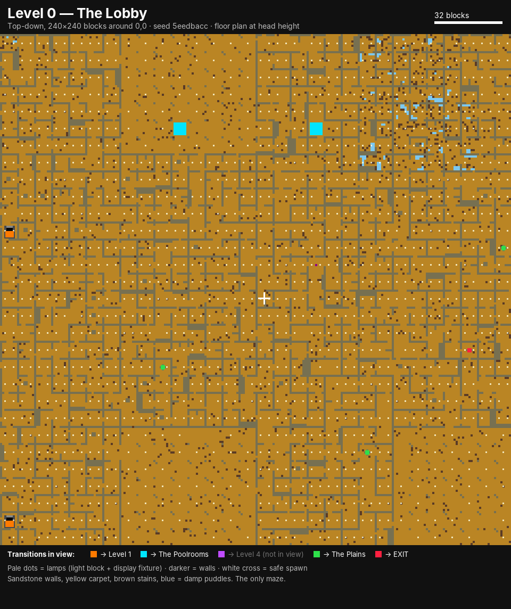
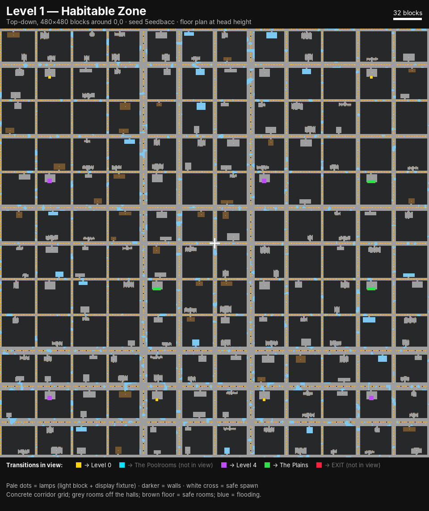
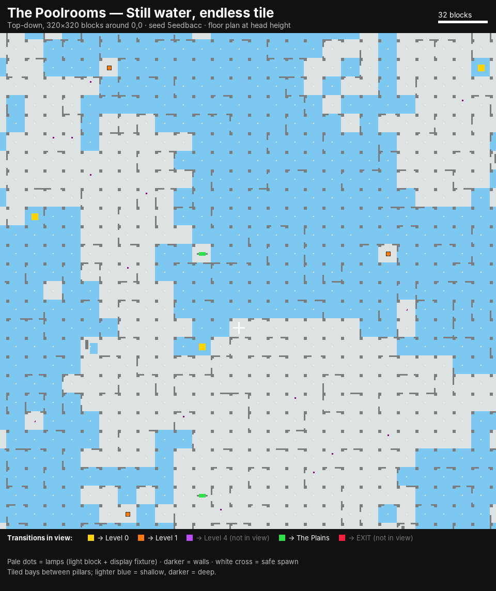
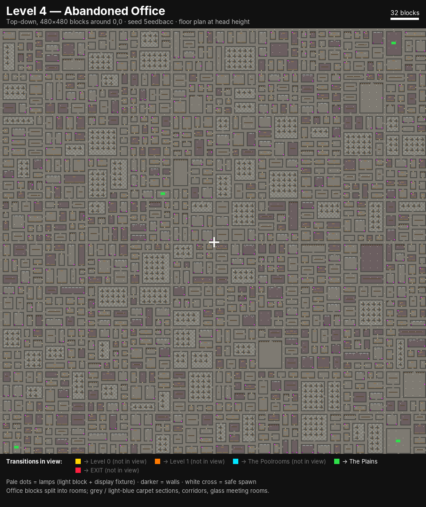
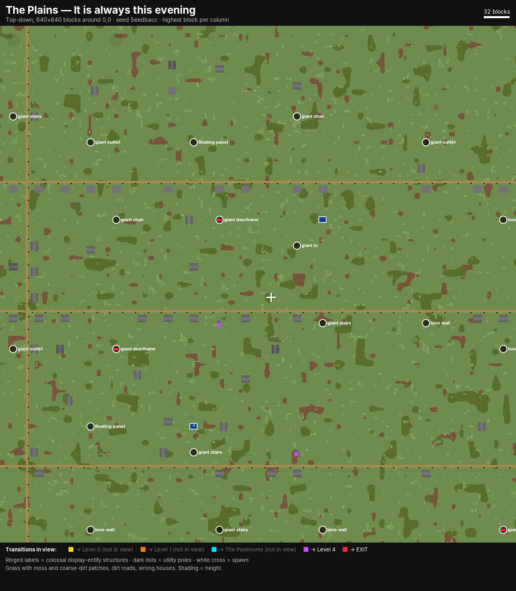

# Backrooms — a five-level dimension for Paper 1.21.11

Backrooms adds a separate alternate reality to a Paper 1.21.11 server. It is built from five generated worlds, display-entity props, surface details and creatures, light effects, fog, and an original positional soundscape. Players need no mods. Custom audio arrives through a resource pack that is bundled inside the plugin JAR; without it, players hear vanilla fallback sounds. The worlds never touch the Overworld, the Nether or the End.

| | |
|---|---|
| Server | Paper **1.21.11**, Java 21 |
| Plugin JAR | `build/libs/Backrooms.jar` (one file, about 20 MB: the plugin and the Java resource pack; the Bedrock companion pack is assembled from it on first start) |
| Dependencies | none at runtime; no NMS, no ProtocolLib, no packets |
| Audio | original, synthesised offline, CC0 (see `pack/MANIFEST.md`) |
| Worlds | `backrooms_level0`, `backrooms_level1`, `backrooms_poolrooms`, `backrooms_level4`, `backrooms_plains` |

---

## Installation

1. Put `Backrooms.jar` in `plugins/` and start the server once. The five worlds are created on first start; each takes a few hundred milliseconds. The resource pack is extracted to `plugins/Backrooms/resourcepack/Backrooms-pack.zip`, and the Bedrock pack is assembled next to it, reusing the same audio.
2. **Custom audio (optional but recommended):** clients download resource packs from a public URL, which a plugin cannot provide on its own.
   - **Default, mc-packs.net:** upload `plugins/Backrooms/resourcepack/Backrooms-pack.zip` at <https://mc-packs.net> once per plugin version. Its download link is `https://download.mc-packs.net/pack/<sha1>.zip`, which is exactly what `resource-pack.url` resolves to (the console prints the SHA-1). Then run `/backrooms audio reload`.
   - **Any other HTTPS host:** set `resource-pack.url` (you can use `{sha1}` in it).
   - **Built-in host:** set `resource-pack.host.enabled: true` with a port your host exposes publicly and a `public-address`.

   The plugin checks the URL and **only offers the pack once the URL answers**. Until then the console says what is missing and players keep the vanilla sounds. `/backrooms audio status` shows the state.
3. **Bedrock players (Geyser/Floodgate):** they never receive the Java pack. To try custom sounds for them, copy `plugins/Backrooms/resourcepack/Backrooms-bedrock.mcpack` into Geyser's `packs` folder, restart, and set `bedrock.custom-sounds: true`. This is **untested**; see the limitations below.
4. Edit `plugins/Backrooms/config.yml` if you want to, then restart the server or run `/backrooms reload`.
5. Enter with `/backrooms enter` (this needs `backrooms.use`, which everyone has by default) or `/backrooms enter <player>`.

> **Upgrading from an earlier build:** this version uses generator version 3 (new palettes, the parking garage, new transitions). Existing level worlds keep their old blocks and log a warning, and new chunks would not match old ones. Delete the `backrooms_*` world folders and their entries in `plugins/Backrooms/data/worlds.yml` to regenerate. Display details, fog and audio also work in old worlds, because none of them is stored in the world.

> Use `/backrooms reload` rather than `/reload` or plugin managers. The worlds keep a reference to the generator, so hot-swapping the JAR is not supported.

**Building from source:** run `./gradlew build` (or `gradle build`). The API comes from `repo.papermc.io`. If that host is unreachable, pass a local Maven mirror with `-PlocalPaperRepo=/path/to/repo`. The JAR in this branch was built that way, against a Paper API 1.21.11 compiled from PaperMC's `ver/1.21.11` source.

---

## How players experience it

- **Getting in:** there are two ways:
  - **Suffocate in sand, gravel or concrete powder** (anything that falls) outside the Backrooms for about 2 seconds. Reality gives way, and you take no suffocation damage while it counts. Ordinary suffocation in a normal wall is never affected.
  - Run `/backrooms enter`. It can be turned off and limited to certain worlds. Admins can also send players in.

  Either way you **fall in**:
  - You appear high in the dark above Level 0, looking down, and fall straight down with your sideways movement locked.
  - Just before you reach the roof, a 3×3 shaft opens through the roof and ceiling.
  - You land in the Lobby with no fall damage, and the shaft closes behind you about 2 seconds later.

  Each entry lands in a different part of Level 0, so players don't all share one spot. The place they left from is saved as their **return point**.
- **Moving between levels:** the levels form a chain: **Level 0 → Poolrooms → Habitable Zone → Office → Plains → exit**.
  - Past Level 0, every district holds the way onward. A rarer way back to the previous level appears in about 40% of districts.
  - Level 0 is the exception. Its only way on, the cold seam into the Poolrooms, appears in about a third of districts (roughly one per 550 blocks of maze). It only gives itself away with a sound when you are within 10 blocks.
- **Getting out:** players have to reach the end. The only exit is the giant doorframe in the Plains. `/backrooms leave` is admin-only by default. Dying also returns the player to their return point (`death.mode: RETURN`).
- **Surviving:**
  - Generated barrels hold limited supplies the first time they are opened: Almond Water, rations, batteries, flashlights, and damp notes that hint at the transitions.
  - **Sanity** drains in the dark and near creatures. It recovers in light, in safe rooms and near other players.
  - Low sanity brings whispers, a heartbeat, nausea and private hallucinations.
  - The **Flashlight** casts a moving light that only clients see.
  - Answering a ringing phone gets a whispered direction and distance to the nearest way onward. Radios carry warnings about the creatures.

### Transition map

| From | Structure (trigger) | To | How often |
|---|---|---|---|
| Level 0 | Cold tiled seam (crouch against it, or stand there for 3 s) | Poolrooms | ~35% of districts |
| Poolrooms | Grey service-door booth | Habitable Zone | every district |
| Poolrooms | Black drain at the bottom of an 8-deep pool | Level 0 (back) | ~40% |
| Habitable Zone | Elevator lobby (stand in the car for 2 s) | Office | every district |
| Habitable Zone | Flooded tiled stairwell (go down into the water) | Poolrooms (back) | ~40% |
| Office | A window that is far too bright | Plains | every district |
| Office | Stairwell in the largest room | Habitable Zone (back) | ~40% |
| Plains | Giant free-standing doorframe | **Exit** | every district |
| Plains | Bunker hatch in the grass | Office (back) | ~40% |

The yellow house and the backyard pools are still in the Plains, but they lead nowhere now.

---

## The five levels

**Lighting rule:** there are no light-emitting blocks anywhere: no lanterns, froglights, sea lanterns, end rods, glowstone, torches or bulbs. Every light source is an invisible `LIGHT` block behind a display-entity fixture model, such as a recessed troffer, tube light, cage lamp, skylight or pool lamp. Some fixtures are dead and some flicker; blackouts dim the fixture models along with the light.

**Surfaces:** each level has its own palette, and pattern comes from real blocks: wallpaper seams, wainscots, grout grids and carpet tiles. Thin **display overlays** add what a block cannot (see *Surface details* below):
- architecture: ceiling seams, coping, trims, pipes, ducts, grilles, sills, outlets;
- deterioration: water stains, faded and peeling paper, cracks, rust and damp patches.

Deterioration is clustered by smooth noise, so most surfaces are clean and damage concentrates in a few worn areas.

Each level uses a **different generation rule**:

**Level 0 — The Lobby.** *The only maze.* 8-block cells joined by a spanning tree with extra loops.
- Blocks:
  - Walls: end stone, with birch-plank wallpaper seams every 4 blocks over a stripped-birch wainscot. Some wall sections are a warmer smooth sandstone, in broad patches.
  - Floor: yellow terracotta carpet with sparse brown stains.
  - Ceiling: bone-block tiles.
- Fixtures: long recessed fluorescent troffers.
- Displays:
  - ceiling panel seams;
  - rare water stains with drip runs creeping from corners;
  - faded rectangles where something hung, peeling wallpaper, ceiling stains.
- Thick walls, stub walls, pillar cells and open halls; dark, low-ceilinged and damp sectors; regions that repeat their neighbour.

**The Poolrooms.** *One continuous hall of bays.* 12-block bays between 2×2 pillars; nothing is a corridor.
- Bay types:
  - dry, shallow or deep (3–8 blocks) bays, with deeper bays under taller ceilings;
  - raised dry platforms, one step up;
  - terrace pools, a pool held one level higher;
  - submerged quartz steps in deep pools, so you can walk out instead of climbing.
- Blocks: smooth quartz tile with a white-concrete grout grid every 4 blocks, light-blue pool lining with the same grid under water, and pillars with pale-blue accent bands.
- Displays: pool-edge coping along every dry/wet boundary, drain covers on pool floors, softened pillar corners, small recessed grilles. It is kept exceptionally clean, with no aging.

**Level 1 — Habitable Zone.** *An endless underground parking garage.* One continuous low concrete floor plate made of 32-block bays.
- Layout: each bay has a drive aisle with a dashed centre line and a row of stalls either side, marked with yellow lines. Polished-andesite columns sit at the back of the stalls, under beams. Some bays have a partition wall with gaps.
- Blocks: smooth stone floor with broad andesite discolouration, plus tuff and puddles only in worn zones.
- Displays: pipe runs with brackets and rust, ventilation ducts, a junction box with conduit, vent grilles and wall joints, column moisture streaks, floor and ceiling cracks.
- A few stalls hold parked cars, some under dust sheets.
- **Rare supply rooms** appear in about 6% of bays. About a third of them are **safe rooms** (wooden floor; creatures never enter, sanity recovers).

**Level 4 — Abandoned Office.** *Partitioned, not carved.* 48-block city blocks are split into rooms by binary space partitioning, with a perimeter corridor.
- Rooms by size: open-plan desk farms, glass meeting rooms, break rooms, offices, closets, storage.
- Blocks: white concrete walls on a light-grey skirting, a smooth-quartz ceiling, and light-grey stained-glass meeting rooms. Carpet is laid in sections (mostly grey, some light blue), with a 2×2 tile pattern in the desk farms.
- Displays: suspended-ceiling grid lines, drywall joints, outlets, cable channels in the farms, window sills and heads, ceiling vents. Rarely, peeling paint and damp ceiling stains.
- Furniture stays sparse. Some rooms are completely unlit.

**The Plains.** *Open sky, stuck at evening.* A near-featureless flat field.
- Ground: about 90% grass, 7% moss and 3% coarse dirt, always in correlated patches.
- Vegetation: sparse short grass in loose drifts, rare tall grass, and rare very shallow hollows.
- Display grass-blade clumps, some of them pale and dry.
- Sparse dirt roads lined with utility poles, and identical white houses with something wrong with them. Colossal display structures stand on the horizon (see the tracking-range note below).
- A Faceling watches from the field.

> Distant colossi need clients to track entities far away. Raise `world-settings.default.entity-tracking-range.display` in `spigot.yml` if they pop in late; `displays.outdoor-activation-radius-chunks` controls how far they spawn.

### Fog

Fog uses no packets or resource pack. The client draws fog at the edge of the chunks the server sends it, so Backrooms lowers each player's **send view distance** inside a level:

| Level | Resting fog distance |
|---|---|
| Poolrooms | 7 chunks |
| Habitable Zone | 5 chunks |
| Plains | 6 chunks, with drifting ash |
| Level 0, Office | unchanged (walls do that job) |

The `fog` event rolls a fog bank in for 1–2 minutes: 3 chunks, with thick ash particles that only that player sees. The player's normal view distance is restored when they leave the Backrooms. Configure it under `fog:`.

### Sound

Every sound is original: synthesised offline with numpy/scipy, plus espeak-ng formant voices for speech. The pack is CC0. The pipeline in `tools/audio/` is deterministic, and two runs give byte-identical files. `pack/MANIFEST.md` lists every asset, how it was made, and how to add your own licensed tracks.

The pack has 58 sound ids, 216 sound events and 683 Ogg Vorbis files. All of them are mono and positional, except two stereo ambient music mixes. Pack size: 22.5 MB.

Where sounds are in the pack, they come in several versions: a dry take plus pre-reverberated versions for each room type (carpet, office, concrete, pool, corridor, open), and low-passed "muffled" versions for sources behind walls. The engine picks one by room and line of sight. Every loop is exactly 8, 10 or 12 s with faded ends.

| Level | Loops (from real sources) | Events (rare ones marked *) | Music |
|---|---|---|---|
| Level 0 | ballast hum at every lit fixture; a denser hum under clusters | flicker crackle, pops, distant knocks and impacts, footsteps*, whispers behind you*, arcs* | `lobby_1/2`*, muffled, from somewhere just past the lights |
| Poolrooms | water lapping, pool circulation, damp room tone | drips near and far, splashes*, bubbles, tile footsteps*, murmurs*; underwater, only a muffled water bed | `pool_1/2`*, positional, with pool reverb |
| Habitable Zone | vents and ducts, transformer buzz at junction boxes, distant machinery | creaks, pipe knocks, drips, machines starting*, concrete footsteps*, conversations behind walls* | `garage_1`*, with concrete reverb |
| Office | air conditioning at vents, fluorescent hum | clicks, printer, phone*, broken speaker*, conversations*, PA announcements*, spoken lines* | an old radio on a few desks playing `office_radio_1/2`, clearer as you approach |
| Plains | none; long silences | grass rustle, distant unidentified sounds*, a far cry* | `plains_1/2`*, very rare, stereo, never constant |

Flickers and blackouts are synchronised with the light effects.

### Maps

Top-down maps rendered from the real generators (seed `5eedbacc`, centred on 0,0). Regenerate them with `RENDER_MAPS=docs/maps gradle test --tests '*MapRenderTest'`.

| | |
|---|---|
|  |  |
|  |  |
|  | |

---

## Creatures and anomalies

None of these is a renamed vanilla mob. Each is a coordinated group of display entities with smooth interpolated motion and limb animation, moved by a bounded A* search over real blocks. Creatures that can be hit have a real `Interaction` hitbox, and damage follows the attacker's attack-damage attribute and cooldown.

| Type | Levels | Class | Behaviour and counterplay |
|---|---|---|---|
| **Smiler** | 0, 1 | threat | Floating grin and eyes, found only in the dark. Freezes while watched; stare for about 4 s and it dissolves. Creeps forward when you look away. Light at ≥11 keeps it at bay. A giggle warns you when it is close. |
| **Faceling** | all | sighting | Tall and faceless. Stalks at 12–20 blocks and leaves when stared at. Harmless, but drains sanity; also appears as **private hallucinations**. **In the Plains** it stands 40–70 blocks out in the field, comes 7 blocks closer every 7 s you don't look at it, and leaves when stared at for 5 s or approached within 18 blocks. |
| **Hound** | 1 | threat (killable, 30 HP) | Quadruped. **Hunts by sound** (sprinting is loud, sneaking almost silent) and by sight. Growls and lowers its head before a lunge. Flees when badly hurt. |
| **Watcher** | 0, 1, 4 | stalker (hit it and it is gone) | A flat black silhouette at the end of a hall. While anyone looks at it, it does not move at all; the moment nobody is, it closes the distance fast and silently. Stare it down for about 7 s and it disappears. If it reaches you: damage, darkness, and the lights flicker. |
| **Drifter** | Poolrooms | threat (20 HP) | Pale shape in deep water. Bubbles warn you. It drags swimmers down; leave the water or strike it. |

Creatures notice everyone except spectators, so they also appear and stalk around **creative-mode** players (useful for testing). They only ever **hurt** players in survival or adventure mode.

Spawning is deliberately rare:
- Each player gets an attempt every 15 s, with chances per level.
- Caps apply per player (2) and per level (8).
- Creatures never spawn in safe rooms or in plain sight (Facelings excepted).
- Each type has its own placement rules (Smilers in the dark, Drifters in deep water).

## Environmental events

`flicker`, `blackout` (raises spawn chances), `lights_out` (lights die one by one toward you), `footsteps`, `knocking`, `door_behind` (a real door behind you opens, then closes), `machinery`, `pool_echo`, `phone_ring`, `wind` (Plains), `fog` (a fog bank rolls in: Plains, Poolrooms, Habitable Zone), `deja_vu` (a hallucination), `hum_shift`.

For players with the pack, flickers crackle at the fixture, and blackouts wind the ballast hum down and back up. The vanilla versions of these events still play for everyone else.

All light effects are **client-side only** (`sendBlockChange` on the invisible `LIGHT` blocks, plus dimming the fixture models). The world is never modified, so a crash can never leave lights broken.

---

## Commands

| Command | Permission | Notes |
|---|---|---|
| `/backrooms help` | `backrooms.use` | Player and admin help |
| `/backrooms enter [player]` | `backrooms.use` (self, if `entry.allow-self-enter`) · `backrooms.admin.teleport` (others) | Safe entry into Level 0; saves the return point |
| `/backrooms leave [player]` | `backrooms.admin.teleport` (or self, if `entry.allow-self-leave`) | Back to the saved return point or the fallback |
| `/backrooms level <0\|1\|poolrooms\|4\|plains> [player]` | `backrooms.admin.teleport` | Admin spawn if set, otherwise the safe cell nearest the origin |
| `/backrooms levels` | `backrooms.use` | The five levels and their status |
| `/backrooms setspawn [level]` | `backrooms.admin.teleport` | Stand in the level; the spot is validated as safe |
| `/backrooms status` | `backrooms.admin.debug` | Worlds, players, loaded chunks, threats per type, display counts, generator info, average tick cost |
| `/backrooms entity list` | `backrooms.admin.entities` | Creature catalogue |
| `/backrooms entity spawn <type> [amount]` | `backrooms.admin.entities` | Uses the natural placement rules, with a fallback in front of you |
| `/backrooms entity clear [radius\|level [level]]` | `backrooms.admin.entities` | Clearing a whole level needs `/backrooms confirm` within 15 s |
| `/backrooms event list` | `backrooms.admin.events` | |
| `/backrooms event trigger <event> [level]` | `backrooms.admin.events` | For yourself, or for every player in the named level |
| `/backrooms reload` | `backrooms.admin.reload` | Restarts services without unloading worlds or duplicating schedulers |
| `/backrooms debug <on\|off>` | `backrooms.admin.debug` | Action-bar overlay (level, cell, zone, nearest transition, light, sanity) plus a console log |
| `/backrooms give <almond_water\|flashlight\|battery\|ration\|note> [player]` | `backrooms.admin` | For testing |
| `/backrooms audio status` | `backrooms.admin.audio` | Engine state, sound count, pack validity, SHA-1, URL and whether it answers, players with the pack loaded, your own pack status |
| `/backrooms audio reload` | `backrooms.admin.audio` | Re-extracts and re-validates the pack if needed, re-checks the URL, restarts the engine |
| `/backrooms audio test <sound> [player]` | `backrooms.admin.audio` | Plays one sound id (tab-completes every id) in front of the player, in their current room profile |
| `/backrooms audio debug` | `backrooms.admin.audio` | Action-bar overlay: acoustic profile, underwater, active loops, seconds to the next event, last event |
| `/backrooms confirm` | — | Confirms a pending destructive action |

Commands work from the console wherever a target player or level is given. Alias: `/br`.

**Permission defaults:**

| Permission | Default |
|---|---|
| `backrooms.use` | everyone |
| `backrooms.admin` and its children (`.teleport`, `.entities`, `.events`, `.debug`, `.reload`, `.audio`, plus `backrooms.bypass.commands`) | op |
| `backrooms.bypass.protection` | nobody (build inside the Backrooms) |

---

## Configuration reference (`config.yml`)

| Key | Meaning |
|---|---|
| `seed` | Base seed; `0` picks a random one once. **Locked**: stored in `data/worlds.yml` |
| `world-prefix` | World folder prefix |
| `levels.<level>.enabled` | Load this level's world. A disabled level's transitions show "the way is sealed". Players left in a disabled level are sent home when they join |
| `levels.<level>.biome` | Biome key for ambient particles, sounds and water colour |
| `levels.<level>.generation.*` | **Locked** per level when its world is created. Each level has its own keys: Level 0 has hall, thick-wall, repeat and loop chances plus `poolrooms-chance` (how rare the seam onward is); the Habitable Zone has `supply-room-chance`; the Poolrooms have water ratio and screens; Level 4 has the room-light chance; the Plains have road, house and colossus chances. Every level past Level 0 also has `back-chance` (the way back), plus landmark chance and decoration density |
| `entry.allow-self-enter` / `allow-self-leave` / `allowed-worlds` / `spread-radius` / `title` | Entry rules |
| `entry.fall.enabled` / `entry.fall.height` | Enter by falling from this many blocks above the roof (default 90); off = instant teleport |
| `entry.suffocation.enabled` / `entry.suffocation.seconds` | The sand/gravel suffocation trigger and how long it takes (default 2 s). It honours `allowed-worlds` and needs `backrooms.use` |
| `return.fallback-world` | Used when a return point is missing or its world is gone |
| `death.mode` | `RETURN`, `LEVEL0` or `STAY`. `death.keep-inventory` keeps items and XP for deaths inside |
| `restrictions.*` | Block protection, ender pearls, chorus fruit, portals, beds, music suppression, `blocked-commands` (e.g. `home`, `spawn`, `tpa`, `warp`, `back`) |
| `transitions.*` | Arrival cooldown, dwell/intent times, arrival protection |
| `displays.*` | Activation radius (chunks), `outdoor-activation-radius-chunks` (Plains, default 8), `max-entities-per-chunk` (default 80), `max-entities-per-world`, chunks per tick, animation interval, view range, hazards on/off |
| `displays.details.*` | Surface details. `enabled`, `performance-mode` (keeps only the most important architectural details), `density`, `aging` (deterioration intensity) and `environment` (small extras), each 0–2. Also `max-per-chunk` (default 28, on top of the props), `view-range` (default 0.45 = 29 blocks), and `levels.<level>.enabled` / `.density` |
| `fog.*` | `enabled`, `bank-view-distance` (default 3), `levels.<level>` resting fog distance in chunks (0 = leave alone) |
| `audio.*` | Toggles: `enabled`, `ambient`, `music`, `voices`. Tuning: `event-density`, `rare-frequency`, `music-frequency`, `max-sources` (simultaneous loops per player, default 6), `distance-scale`, `acoustic-quality` (`low`/`medium`/`high`), and `levels.<level>` loudness 0–2 |
| `resource-pack.*` | `enabled`, `url` (default mc-packs.net with `{sha1}`), `required` (kick players who decline), `prompt`, and `host.enabled` / `bind` / `port` / `public-address` for the optional built-in server |
| `bedrock.custom-sounds` | Treat Bedrock players as having custom sounds (only after installing the `.mcpack` in Geyser) |
| `creatures.*` | Tick interval, spawn attempt period, caps, despawn distance, `level-chance`, per-type `enabled`/`damage`/`health`/`weight` per level |
| `events.*` | Events on/off, check period, chance, ambience, flicker radius |
| `sanity.*` | Sanity on/off; optional action-bar readout |
| `items.*` | Flashlight battery length |
| `messages.*` | Every player-facing message, in MiniMessage format |

**Locked values** (the seed and `generation.*`) are snapshotted the first time a level's world is created. Later edits only affect levels whose worlds do not exist yet, so existing worlds never develop seams. The snapshot lives in `plugins/Backrooms/data/worlds.yml`. Writes are atomic and the previous version is kept as `.bak`. **Back this file up with your worlds.**

---

## Architecture notes

- **Dimension:** five server-created worlds with the NORMAL environment and custom `ChunkGenerator`s.
  - All vanilla stages are disabled: noise, caves, decorations, structures and mob spawning.
  - The worlds use fixed time (midnight indoors, evening in the Plains), no weather, no mob spawning, a random tick speed of 0 and no fire spread.
  - Indoor levels are sealed with bedrock top and bottom; the Plains has a bedrock floor and open sky.
  - Paper cannot add new client-side dimension types; players experience the five worlds as one reality because the plugin moves them with controlled teleports.
- **Generation:** a pure function of (seed, coordinates), so it is thread-safe and seamless across chunks.
  - Every level has its own layout rule (maze, corridor grid, bay hall, BSP office blocks, open field), but all are organised into **regions** and **districts**; each district receives the level's guaranteed transitions, and each layout is checked for full reachability by the tests.
  - Zones come from smooth noise sampled per cell, so style borders never cut through a room.
  - All water is contained still source water, and flowing is additionally cancelled.
- **Display subsystem:**
  - About 80 authored models: BlockDisplay, ItemDisplay, TextDisplay and Interaction.
  - Animation: spin, sway, bob, jitter, slide, orbit, blink and flicker, sent with display interpolation.
  - Scripted behaviours: elevator doors, a ringing phone, lamp dimming during events.
  - Emitters, telegraphed hazards, and interactions (bell, phone, radio, vending machine).
  - Props are derived from the layout, so they are **never saved**. They are spawned near players within per-chunk and per-world budgets, spread across ticks, and removed when out of range, when the chunk unloads, and on disable.
  - Every entity is non-persistent and tagged in its PDC; tagged leftovers are swept when chunks load.
  - Props that need collision get invisible barrier blocks from the generator. Lamps get invisible light blocks.
- **Surface details** (`display/Details.java`): one shared parametric vocabulary used by every level, with ids like `d:strip:<block>:<len>:<h>:<d>`, `d:wpatch`, `d:crack`, `d:peel`, `d:pipe`, `d:coping`.
  - Each generator emits them from its own layout knowledge in `cellDetails`. Wall details are placed through a helper that knows each wall's orientation, and every overlay sits 0.003–0.009 blocks off its surface, so nothing z-fights.
  - Each detail carries a **tier** (architecture, aging, environment) and a deterministic **rank**. The runtime keeps a detail only while its rank is below the configured density for its tier, so turning density down removes the same details everywhere, consistently.
  - Details are sorted after functional props and capped per chunk, so a budget never drops a lamp.
  - Being display entities derived from the layout, they apply to existing worlds without touching any block or player build.
  - Displays stretch their texture when scaled, so large overlays only use near-uniform blocks. Patterned surfaces are real blocks.
- **Audio engine** (`audio/`): all synthesis is offline. At runtime the plugin only schedules, positions and manages playback.
  - **Emitters** are derived per chunk from the same layout data as the props (bounded LRU cache):
    - every lit fixture hums;
    - ducts and vents blow;
    - pools lap and circulate;
    - junction boxes buzz;
    - occasional heavy machinery is "somewhere else";
    - a few radios and speakers play music.
  - **Loops:** for each player the nearest `max-sources` emitters are kept going by re-triggering each sample at its own position just before it ends; samples have faded ends so they cross-fade. Only one music source plays per player at a time.
  - **Events** come from per-level weighted tables with per-event cooldowns, a recent-history penalty, separate long cooldowns for voices and music, and deliberate silence between events (now and then several minutes of it).
  - **Acoustics:**
    - A room profile (carpet, office, concrete, pool, corridor, open) comes from the level and from four bounded horizontal probes plus the ceiling height. It selects pre-reverberated variants.
    - A bounded ray march (half-block steps, at most 32 blocks) counts occluding blocks to select pre-filtered "muffled" variants.
    - Impacts in hard rooms get one delayed, quieter reflection.
    - Underwater, a muffled water bed replaces everything else.
  - The client's own distance attenuation and panning make every source locatable. Long music is never restarted mid-track; obstruction is decided when a track starts.
  - Players without the loaded pack keep the vanilla ambience instead, and no unregistered id is ever sent (`SoundIndex.resolve`).
- **Resource pack delivery** (`audio/PackManager.java`): the pack is embedded in the JAR and extracted when the plugin version or the pack changes. It is validated (metadata, every `sounds.json` reference present) and hashed with SHA-1.
  - The pack id is derived from the hash, so clients reuse their cached copy when nothing changed.
  - The URL is probed asynchronously (HEAD, then a ranged GET), and players are only offered the pack when it answers.
  - Per-player status comes from `PlayerResourcePackStatusEvent`; custom sounds start only after `SUCCESSFULLY_LOADED`.
  - The optional built-in host (`com.sun.net.httpserver`) serves exactly one path, the pack, for GET/HEAD only.
- **Entry shafts:** before any roof block is removed, the shaft is written to `data/open-shafts.yml`; it is erased once the blocks are put back. If the server crashes mid-fall, any shaft left open is closed on the next start. Block entities (barrels, chests) are never cut.
- **Persistence:** the return point, the "inside" flag (used to detect stranded players) and sanity live in each player's PDC. World metadata and admin spawns live in `data/worlds.yml`. Worlds are never deleted or regenerated. A world created by an older generator version logs a warning; delete its folder (and its entry in `data/worlds.yml`) to regenerate it with the new layout.
- **Threading:** Bukkit calls happen on the main thread. Chunk preparation for teleports uses `getChunkAtAsync`. Generator block states are pre-resolved at startup. Spawn writes are snapshotted on the main thread and written asynchronously.
- **No NMS and no packets.** Client-side light effects use the stable `Player#sendBlockChange` API, and private hallucinations use `Entity#setVisibleByDefault` and `Player#showEntity`.

## Testing

`gradle test` runs 66 automated tests (plus one map renderer that is off by default). All of them pass on this build.

- **Generation (31 tests across all 5 levels):**
  - Determinism across instances and chunk order, and seed sensitivity.
  - **Flood-fill reachability** of every safe spot and every transition trigger, walking real painted chunks the way a player would (walking, stepping, dropping, swimming, climbing).
  - Water is contained and still; bedrock shell (no roof check in the Plains).
  - The chain: every transition leads to the next or previous level only; exits exist only in the Plains; past Level 0 every district has its way onward; Level 0's seam appears in 15–60% of districts.
  - The safe-spot search lands on standable, trigger-free ground.
- **Plugin integration on MockBukkit (15 tests):** world creation and locked snapshots, permissions and tab completion, enter/leave and return points, protection, a stairwell transition with arrival cooldown, creature hitboxes and confirmed clearing, decoration spawn/despawn, clean disable.
  - **The fall entry:** the player starts above the roof, sideways movement is locked, a 3×3 shaft (and only 3×3) opens before the roof, fall damage is cancelled during the fall and just after landing, and the roof and ceiling are restored with no pending shaft left on disk.
  - **The suffocation trigger:** suffocating in sand takes you into Level 0 with no damage; suffocating in stone is left alone.
  - **Creative players:** creatures stay alive around them and never hurt them.
- **Surface details (11 tests):**
  - Every wall overlay has a wall behind it and air in front, on every wall orientation.
  - Ceiling overlays touch the ceiling, and floor overlays rest on something solid.
  - No detail sits in a transition trigger.
  - Repeated chunk generation is identical; nothing is anchored in another chunk or duplicated across chunks; props come before details for budgets.
  - The Plains ground mix is 89.9% grass, 6.9% moss and 3.2% coarse dirt, in patches.
- **Atmosphere (6 tests):**
  - Fog follows the level and is restored on leaving.
  - The embedded pack is extracted, byte-identical and SHA-1-hashed, and re-extracted after a version change or damage.
  - The pack is never offered to an unreachable URL. The built-in host on a real local port serves exactly the pack (404 for anything else) and gets it offered.
  - Status events gate custom audio.
  - Every sound the engine can play exists in the pack.
  - Custom sounds reach only players who loaded the pack, come from the fixtures (not the listener), are never unregistered ids, are not restarted early, and stop when the player leaves.
  - Audio commands work.
- **Models and states (3 tests):** every decoration id (including every parametric detail) builds into a model, and every generator block state is validated by a real block-data parser. Display density stays within budget per chunk:

| Level | Props | Details | Spawned after caps |
|---|---|---|---|
| Level 0 | 25.3 | 9.7 | 35.0 |
| Poolrooms | 9.3 | 10.3 | 19.6 |
| Habitable Zone | 13.4 | 6.7 | 20.1 |
| Office | 27.8 | 9.0 | 36.8 |
| Plains | 4.0 | 1.9 | 5.9 |

### Not verified in a real game: please check in-game

No Paper server binary could be downloaded in the build environment, so nothing has been run on a live server yet, and **no one has listened to the audio**: it was checked only with automated level, loudness, spectrum and loop measurements.

**Known limitations:**
- Vanilla clients cannot apply real-time reverb or filters from a server. Acoustics are approximations: pre-rendered room versions, muffled versions, and one delayed reflection for impacts.
- Music is not sample-synchronised between players. Loops are re-triggered, so a very slight seam is possible on a laggy connection.
- The espeak-ng voices are robotic formant voices.
- **Bedrock:** a companion `.mcpack` with `sound_definitions.json` (both `backrooms:<id>` and `<id>` keys) is generated, but it is untested with Geyser. Whether Geyser forwards these custom sound ids is unverified, so `bedrock.custom-sounds` is off by default.
- mc-packs.net could not be reached from the build environment, so the upload itself is your step.

**Checklist:**

1. **Upgrading:** delete the old `backrooms_level2/3/5` folders and any world that logs an old generator version, then start the server. The five worlds should be created without errors, and `/backrooms status` should show them.
2. **Visual pass, one `/backrooms level <x>` per level:** palettes, light levels, fixture models lining up with the ceiling `LIGHT` blocks, and prop orientation against walls.
3. **The Plains:** colossi visible at distance (see the tracking-range note), house variants, the fixed evening sky.
4. **The fall entry:** the sky start, the elytra wind sound, the shaft opening in time on a laggy connection, landing with no damage, and the ceiling closing. Bury yourself in sand in the Overworld to test the suffocation trigger.
5. **Each transition:** trigger feel, arrival spot, no bounce back. The Poolrooms slide push. Seam intent (crouch). The drain and the backyard pool dive.
6. **Creature behaviour and fairness:** creatures spawning naturally within a minute or two (watch `/backrooms debug on`); the Watcher freezing exactly while watched; Smiler freezes when looked at; Hound sound tracking and lunge; Drifter grab and release; the Plains Faceling approaching only while unwatched; clicking `Interaction` hitboxes with real clients.
7. **Client-side effects:** that a `LIGHT` block sent by `sendBlockChange` relights on real clients (flashlight, flicker, blackout, lights out).
8. **The `door_behind` event:** the door opens and closes back cleanly.
9. **Death in each `death.mode`;** joining after a level was disabled (stranded recovery); ender pearl and chorus blocking; blocked commands.
10. **Audio:**
    - Upload the pack and watch `/backrooms audio status` reach REACHABLE.
    - Accept the pack; hums should be locatable under fixtures; `/backrooms audio debug`; `/backrooms audio test <id>`.
    - Check that loops have no audible seam, and that muffled music clears up as you round a corner.
    - Check the Office radio and how the Poolrooms sound underwater.
11. **Fog:** the resting fog distances, a `fog` event (`/backrooms event trigger fog`), and the normal view distance coming back on leaving.
12. **Surface details:** look for alignment, z-fighting and anything blocking a doorway, at `displays.details.density` 1 and 2.
13. **Performance with several players:** watch `/backrooms status` tick costs, then tune `displays.activation-radius-chunks` and the entity caps if needed.
